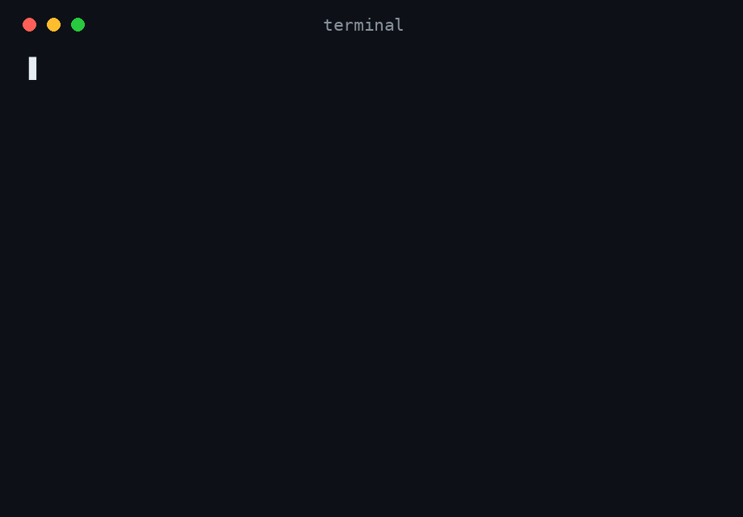

# qrcli

**QR codes from your terminal. Zero dependencies.**



qrcli makes QR codes with nothing but the Python standard library — the
encoder is written from scratch (Reed–Solomon error correction and all), so
`pip install qrcli` pulls in **no dependencies at all**, works fully offline,
and never sends your payload anywhere.

## Install

```bash
pip install qrcli-py
```

## Quick start

Print a QR code straight in your terminal:

```bash
qrcli "https://example.com"
```

Save it as an image instead (PNG or SVG, picked from the file name):

```bash
qrcli "https://example.com" -o code.png
qrcli "https://example.com" -o code.svg
```

### Wi-Fi codes your guests can scan

```bash
qrcli wifi --ssid "MyHomeWiFi" --password "s3cret"
qrcli wifi --ssid "Cafe" --security nopass -o cafe-wifi.png
```

The code uses the standard `WIFI:` payload format supported by iOS and
Android cameras — point a phone at it and it offers to join the network.

### Options

```
-o, --output FILE   output file (.png or .svg); default: print to terminal
--format png|svg    force a format
--ecc L|M|Q|H       error-correction level (default: M)
--scale N           pixels per module for image output (default: 10)
--border N          quiet-zone width in modules (default: 4)
```

Higher error correction (Q, H) keeps the code scannable when it's partly
covered or printed small, at the cost of a denser symbol.

## As a library

```python
from qrcli import encode, Ecc
from qrcli.render import to_png, to_svg, to_terminal

qr = encode("https://example.com", Ecc.MEDIUM)
print(to_terminal(qr))
open("code.png", "wb").write(to_png(qr))
```

## What it supports

- Byte mode (UTF-8), QR versions 1–20, all four error-correction levels
- Automatic smallest-version selection and penalty-based mask choice
- Terminal, PNG, and SVG output — all rendered with the standard library

Decoding QR codes is deliberately out of scope: that needs camera/image
libraries, which would break the zero-dependency promise.

## How it works

The encoder in `qrcli/qr.py` follows ISO/IEC 18004 end to end: segment
header and padding, Reed–Solomon error correction over GF(256), block
interleaving, function patterns, masking with the specification's penalty
rules, and format/version information. Its output was verified
module-by-module against an independent reference implementation and by
decoding the generated codes back with real QR detectors.

## Development

```bash
pip install -e . pytest ruff
pytest
ruff check qrcli tests
```

## License

MIT
